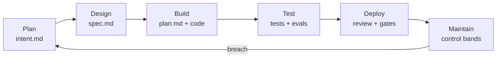

# ai-native-project-template

A starting point for Python projects that build AI agents, RAG or document AI on AWS, developed with
Claude Code. It provides a reproducible dev container, strict tooling, and an AI-native development
lifecycle where every change goes from a written intent to a reviewed, tested and monitored result.
Policies are enforced by hooks and CI rather than left to the model.

> **Status:** template. The local tooling, hooks and agent evals have been run; the GitHub workflows
> run once the repository has the secrets described below.

## What's inside

| Area | What you get |
| --- | --- |
| Dev container | Python 3.12, uv, AWS CLI v2, GitHub CLI, Claude Code, Docker-in-Docker; AWS credentials from a dedicated host folder |
| Python project | Library layout (`src/app/`), settings from environment (`pydantic-settings`), model chosen by config (`MODEL_PROVIDER`, `MODEL_ID`) |
| Quality | ruff, mypy (strict), pytest with coverage, pre-commit (gitleaks secret scan, shellcheck, shfmt, file checks) |
| Local services | Postgres + pgvector via `compose.yaml` (`make db-up`) |
| Editor | VS Code extensions and format-on-save for Python, YAML, JSON and Markdown |
| Dependencies | `uv.lock` pins Python packages; actions and hooks pinned to commits; Dependabot weekly |

## Development lifecycle

Each non-trivial change leaves a trail of short Markdown files in `intent/<date>-<name>/`, each accepted
by merging its pull request. Adapted from Anthropic's
[AI-native SDLC playbook](https://academy.claude.com/courses/ai-native-sdlc-playbook/introduction).



| Stage | In this repo |
| --- | --- |
| Plan | `/intent` skill writes `intent.md`: problem, outcome, constraints, open questions |
| Design | `/spec` skill writes `spec.md` with numbered requirements, applying the `security-policy` and `ai-design-standards` skills and flagging areas of concern |
| Build | Sessions start in plan mode; the accepted plan is committed as `plan.md`. A hook runs ruff after every edit; a `verifier` subagent checks the diff against the plan |
| Test | `CLAUDE.md` defines how work is verified; `/bugfix` commits a failing test first and a hook locks `tests/` during the fix; agent evals in `evals/` regression-test the Claude configuration |
| Deploy | `REVIEW.md` drives `/pr-review` and a PR review workflow; an approval-gate hook asks before guardrail, dependency and AWS changes and blocks commits on `main` and AWS use outside the configured profile and region |
| Maintain | A daily workflow checks the CI failure rate against control bands (plain Python, unit tested); a 3-sigma breach becomes an intent pull request |

## CI workflows

| Workflow | Runs | Needs |
| --- | --- | --- |
| `tests` | Every push and PR: pre-commit, mypy, tests; Claude triage of failures | Claude secret for triage only |
| `agent-evals` | PRs that change `CLAUDE.md`, `.claude/` or `evals/` | Claude secret |
| `claude-review` | Every PR to `main` | Claude secret |
| `maintain` | Daily | Claude secret for diagnosis; "Allow GitHub Actions to create pull requests" |

The Claude secret is either `CLAUDE_CODE_OAUTH_TOKEN` (a Claude subscription, created with
`claude setup-token`) or `ANTHROPIC_API_KEY`. Without one, those steps are skipped with a notice.

## Start a new project

1. Create a repository from this template and clone it.
2. Create the AWS config folder the container mounts, `~/.aws-sandbox`, with an SSO profile named
   `sandbox` (or change the profile and region in `devcontainer.json`, `Makefile`, `CLAUDE.md` and
   `.claude/hooks/approval-gate.sh`).
3. Open the folder in VS Code and choose *Reopen in Container*. Then:

   ```bash
   git config user.email "<id>+<username>@users.noreply.github.com"
   make sso-login
   cp .env.example .env.local
   make check typecheck test
   ```

4. Rename `README.template.md` to `README.md` and describe the project; update "What this is" in
   `CLAUDE.md`.
5. Review the policy skills in `.claude/skills/` so they state your own standards.
6. On GitHub: add a Claude secret, protect `main` (require the `tests` check and one approval), and
   allow Actions to create pull requests if you use `maintain`.

Add dependencies with `uv add <package>`. `make help` lists every command.

### Local Claude files

On first open, the dev container creates `PROJECT_CONTEXT.md` from its template: a git-ignored status
record that `CLAUDE.md` imports into every session. An existing file is never overwritten. Private notes
for a project go in `CLAUDE.local.md`, also git-ignored, created when needed.

## Limitations

- Claude runs in CI use your subscription's limits or API credit.
- Skills are advisory; hooks and CI checks are the enforced layer, and a hook cannot see changes made
  outside Claude Code.
- The `maintain` loop needs about two weeks of CI history before its bands mean anything.
- Outputs of AI features built on this template are analysis, not advice; models can be wrong.

## License

MIT
